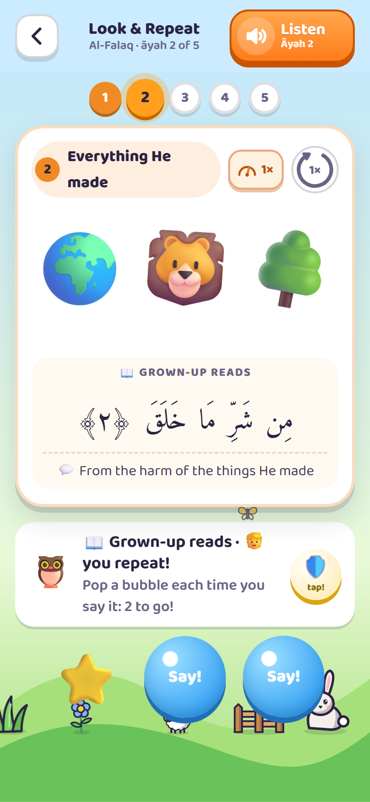
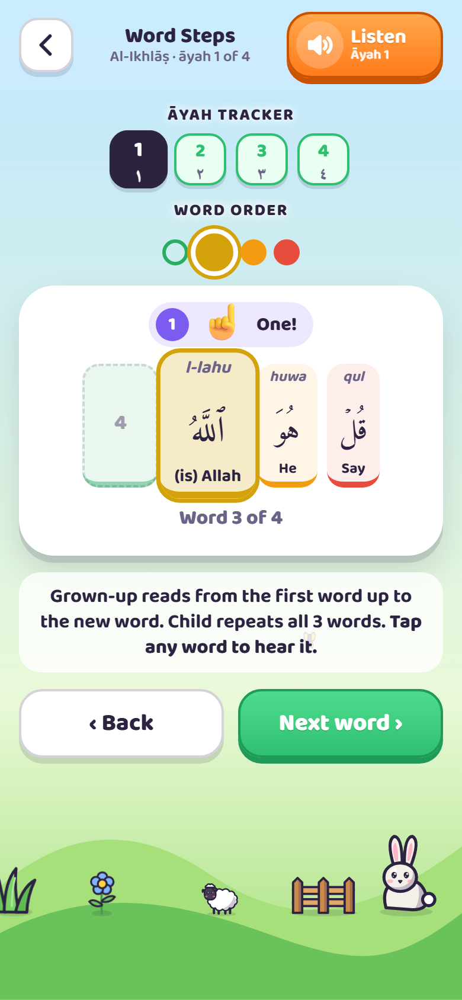
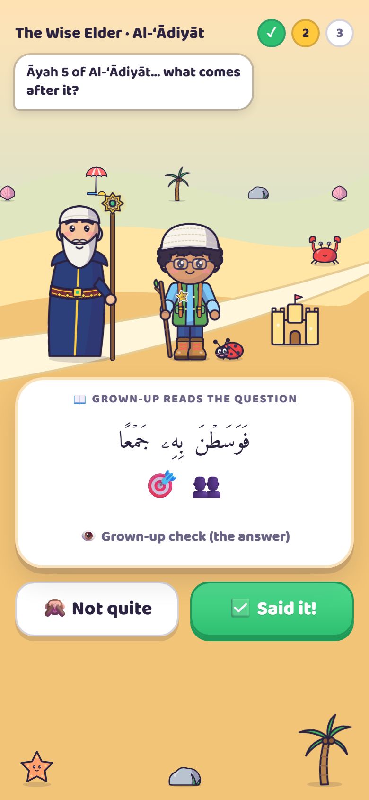

# Little Hafiz Quest

A picture-and-gesture adventure that helps young children (about 4–7) **memorize Juz ‘Amma** (sūrahs 78–114).
A grown-up recites, the child listens, repeats and acts it out, and the clues fade step by step until they
recite on their own.

**Play it:** https://akramali.github.io/little-hafiz-quest/ · free, no ads, no accounts, works offline

<table>
  <tr>
    <td align="center"></td>
    <td align="center"></td>
    <td align="center"></td>
  </tr>
  <tr>
    <td align="center">Begin the quest</td>
    <td align="center">Climb the map</td>
    <td align="center">Pick a step</td>
  </tr>
  <tr>
    <td align="center"></td>
    <td align="center"></td>
    <td align="center"></td>
  </tr>
  <tr>
    <td align="center">Solve the puzzle</td>
    <td align="center">Read the sūrah</td>
    <td align="center">Collect and dress up</td>
  </tr>
  <tr>
    <td align="center"></td>
    <td align="center"></td>
    <td align="center"></td>
  </tr>
  <tr>
    <td align="center">Share the awards</td>
    <td align="center">See the progress</td>
    <td align="center">Reach the summit</td>
  </tr>
  <tr>
    <td align="center"></td>
    <td align="center"></td>
    <td align="center"></td>
  </tr>
  <tr>
    <td align="center">Look &amp; repeat</td>
    <td align="center">Build it word by word</td>
    <td align="center">Walk with the Wise Elder</td>
  </tr>
</table>

> [!IMPORTANT]
> A free helper for parents, not an authority on the Qur'an. The text and recitation come from public sources and
> may contain mistakes: check each āyah against a trusted muṣḥaf or teacher. See the [Disclaimer](#disclaimer).

## Highlights

- **A quest map:** the child's own explorer climbs 7 worlds, from a meadow at An-Nās to the mountain top at An-Naba’.
- **Four steps per sūrah:** 👀 Look & Repeat and Word Steps to learn, then 🐸 Stepping Stones and 🧩 Picture Puzzle to review.
- **Pictures and actions** for every āyah, plus simple meanings, word meanings and transliteration (optional).
- **Read mode** for children who can read the muṣḥaf, following the recitation āyah by āyah.
- **Four reciters**, adjustable speed (0.25×–2×) and loops; tap any word to hear it alone.
- **200+ things to win and wear:** treasures, golden editions, stickers, buddies, toy rides for golden worlds and
  summit awards.
- **The Wise Elder:** a kind old man who now and then walks with the explorer and tests a memorized sūrah, with no help.
- **Family friendly:** up to 10 explorers on one phone, family sync between phones by link or QR code, backups to a file.

Five to ten minutes a day is plenty. Stop while it's still fun.

## Put it on a phone

- **iPhone / iPad:** open the link in Safari → Share → **Add to Home Screen**, and play from there.
- **Android:** open the link in Chrome → ⋮ → **Add to Home screen**.
- **Offline:** ⚙️ Grown-up Corner → Download recitations → **Save all recitations**.

Updates download by themselves; the start screen offers them with a short note of what's new.

## Privacy

No accounts, analytics, ads or trackers, and no requests to other websites. Progress stays on the device; family
sync puts it inside the link you send, never on a server.

## For developers

Plain HTML, CSS and JavaScript, with no build step. Preview with `python3 tools/serve.py` (it supports the Range
requests the audio needs) and open http://localhost:8000/. Content lives in `js/data.js`, drawings in `js/art.js`,
game logic in `js/game.js`. Browser tests: `tests/t.sh list`. [`HANDOFF.md`](HANDOFF.md) has the full map of the
code, the game's rules and the release steps.

Found a mistake or have an idea? [Open an issue](https://github.com/akramali/little-hafiz-quest/issues).

## Disclaimer

Little Hafiz Quest is a free tool, made only to help parents and other grown-ups teach young children. It is provided **"as is", without any warranty**.

- **No guarantee of correctness.** The Arabic text, recitation audio, āyah timings, simple meanings and transliterations come from public sources and were put together with care, but their accuracy and completeness are not guaranteed.
- **You are responsible for checking.** The grown-up using the game is responsible for making sure every āyah and recitation is correct before teaching it, by checking against a trusted muṣḥaf or a qualified teacher.
- **Not a replacement for a teacher.** The simple meanings are written for young children and are not a translation or tafsīr. The game supports, but does not replace, learning with a qualified Qur'an teacher.
- **No liability.** The author accepts no responsibility or liability for errors in the content, for anything a child learns incorrectly, or for any problem, loss or harm arising from using this game. Use it at your own risk.

See also the warranty and liability terms in [LICENSE](LICENSE).

## Credits and licenses

- **Code and drawings** (`index.html`, `css/`, `js/boot.js`, `js/game.js`, `js/map.js`, `js/art.js`, `js/sounds.js`, `js/sync.js`, `sw.js`, `tools/`, `tests/`, `v1/`, `manifest.webmanifest`, `icons/`): MIT, see [LICENSE](LICENSE).
- **QR codes**: `js/qrcode.js` is [qrcode-generator](https://github.com/kazuhikoarase/qrcode-generator) 1.4.4 by Kazuhiko Arase, MIT (included unchanged). "QR Code" is a registered trademark of DENSO WAVE INCORPORATED.
- **Qur'an text** in `js/data.js`: from [quran-json](https://github.com/risan/quran-json) by Risan Bagja Pradana (Uthmani text from [The Noble Qur'an Encyclopedia](https://quranenc.com)), licensed [CC BY-SA 4.0](https://creativecommons.org/licenses/by-sa/4.0/). `js/data.js` adapts it (open tanwīn marks converted to standard Unicode, memory cues added) and is shared under CC BY-SA 4.0 as well.
- **Word-by-word transliteration and meanings** in `words.json`: from the [Quranic Arabic Corpus](https://corpus.quran.com) by Kais Dukes (maintained by the Quran.com team), via the [Quran.com API](https://api-docs.quran.com), under the [GNU General Public License v3](https://www.gnu.org/licenses/gpl-3.0.html) as the corpus requires, with the corpus named as the source. Changed only in how words are grouped where the game splits an āyah differently (see `tools/build_words.py`); for this text every word lines up one to one.
- **Memory cues, simple meanings and āyah transliterations** in `js/data.js`: written for this project, CC BY-SA 4.0. The simple meanings are written for young children and are not a translation; see a full tafsīr for detail.
- **Recitation** in `audio/`: Sheikh Mishary Rashid Alafasy, Sheikh Mahmoud Khalil Al-Husary (Muallim), Sheikh Mohamed Siddiq Al-Minshawi and Sheikh Abdul Basit Abdul Samad, from [EveryAyah.com](https://everyayah.com), joined into one file per sūrah. Word timings from [Quran.com](https://quran.com), with the cut between words moved to the quietest moment. Included for free, non-commercial educational use; all rights to the recordings remain with their owners.
- **Fonts**: [Amiri Quran](https://github.com/aliftype/amiri) by Khaled Hosny and [Baloo 2](https://github.com/EkType/Baloo2) by Ek Type, both under the SIL Open Font License 1.1 (see `fonts/`).
- **Āyah pictures** are the device's own emoji, so they look slightly different on each phone. The explorer, gifts and worlds are drawn for this project (`js/art.js`).
