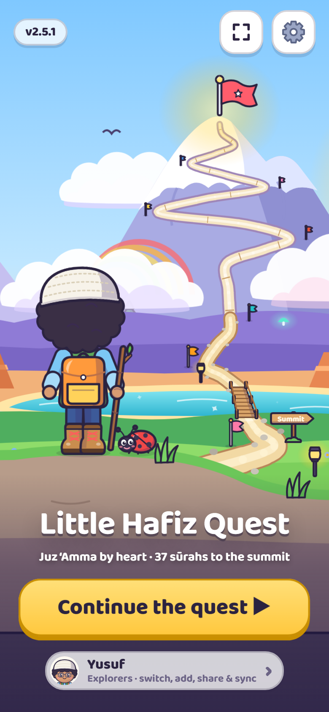
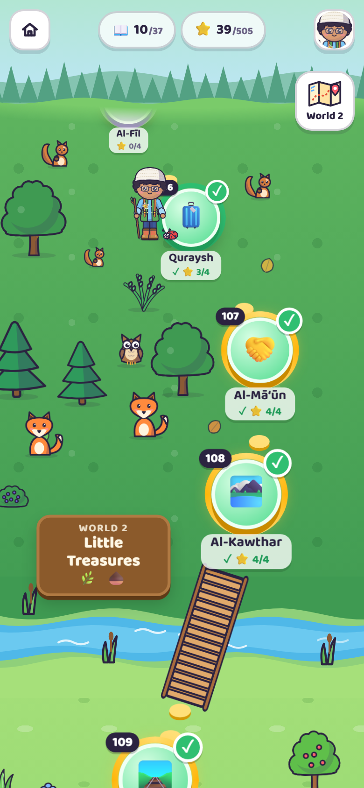
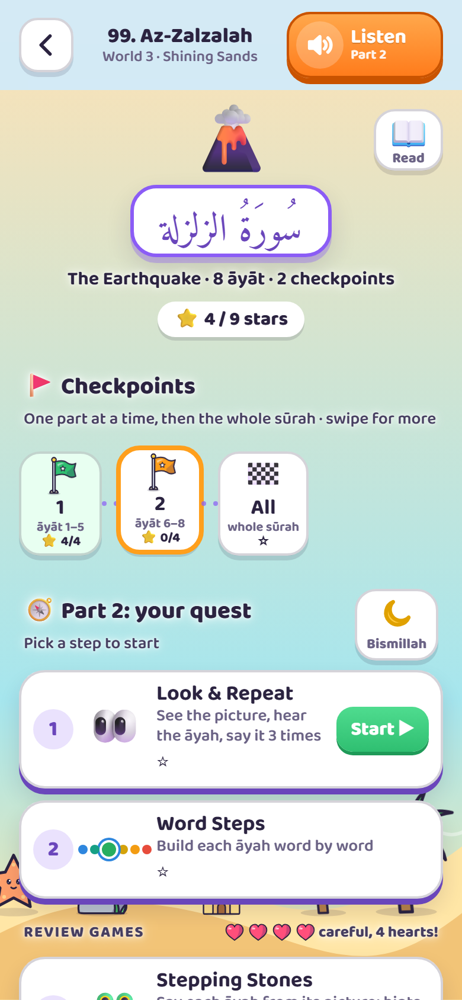
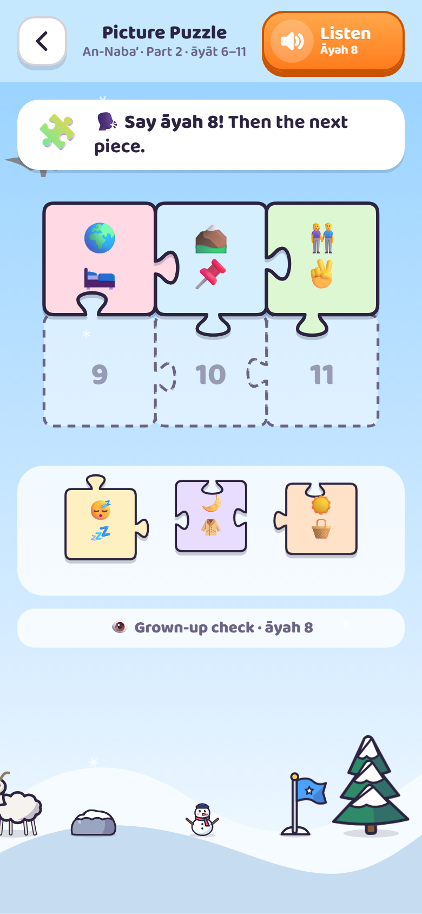
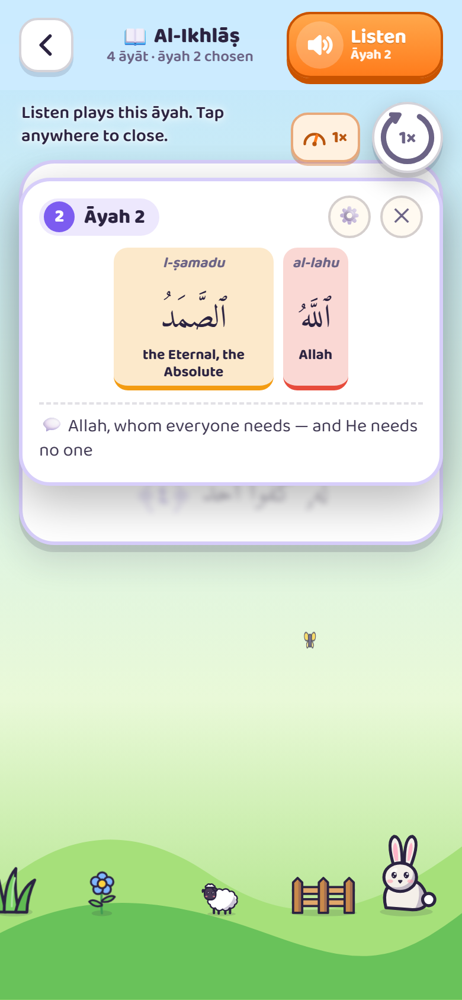
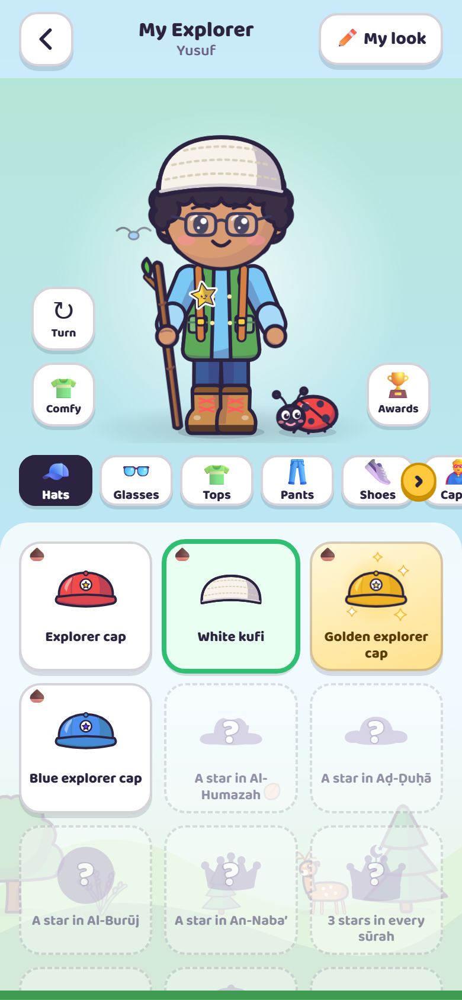
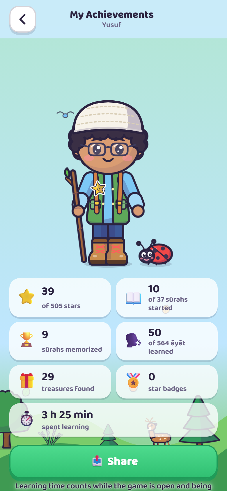
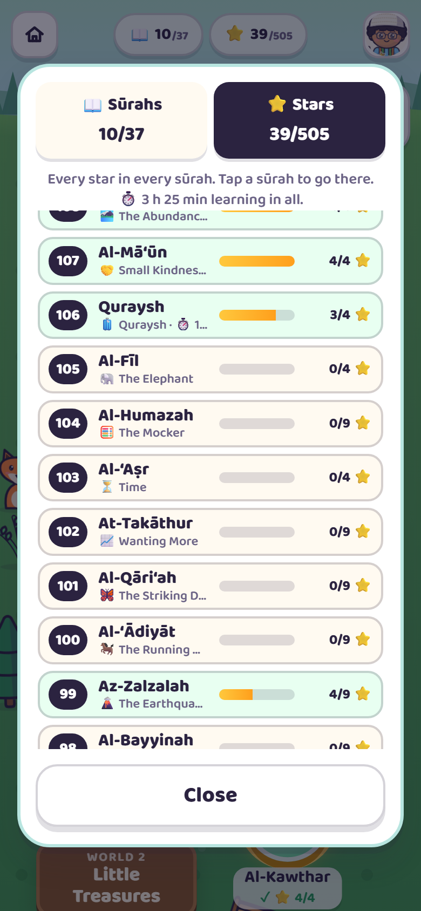
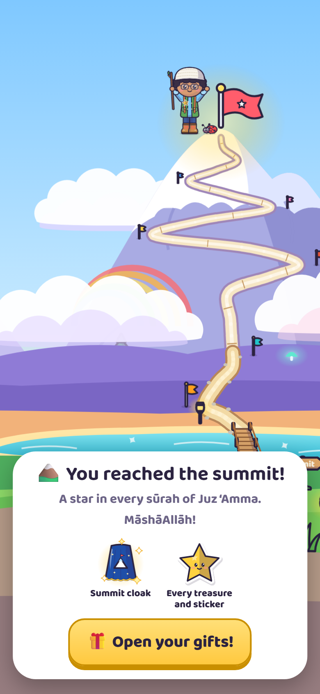

# Little Hafiz Quest

A fun, picture-and-gesture adventure that helps young children (around age 4–7) **memorize Juz ‘Amma**, sūrahs 78 to 114, by heart.

A grown-up who reads Arabic recites each āyah; the child listens, repeats and does a hand action. Every āyah has its own picture and movement, so the picture brings back the words. Step by step, the clues fade until the child recites with no help at all.

Your child's own little explorer starts in a meadow at An-Nās and climbs, sūrah by sūrah, through a forest, a beach, a desert canyon, starry hills and cloud cliffs to the top of the mountain at An-Naba’. Along the way there are over 150 things to win and wear: caps and kufis or hijabs, boots, capes, walking sticks, buddies, an astronaut suit with a toy rocket, and golden editions for the hardest-working explorers.

**Play it:** https://akramali.github.io/little-hafiz-quest/

Free, no ads, no accounts, no tracking. It works on iPhone, iPad, Android, and computers, and keeps working without internet once it's been opened.

<table>
  <tr>
    <td align="center"></td>
    <td align="center"></td>
    <td align="center"></td>
  </tr>
  <tr>
    <td align="center">Begin the quest</td>
    <td align="center">Climb the map</td>
    <td align="center">Pick a step</td>
  </tr>
  <tr>
    <td align="center"></td>
    <td align="center"></td>
    <td align="center"></td>
  </tr>
  <tr>
    <td align="center">Solve the puzzle</td>
    <td align="center">Read the sūrah</td>
    <td align="center">Collect and dress up</td>
  </tr>
  <tr>
    <td align="center"></td>
    <td align="center"></td>
    <td align="center"></td>
  </tr>
  <tr>
    <td align="center">Share the awards</td>
    <td align="center">See the progress</td>
    <td align="center">Reach the summit</td>
  </tr>
</table>

> [!IMPORTANT]
> This is a free helper for parents, not an authority on the Qur'an. The text and recitation come from public sources and are **not guaranteed to be free of mistakes**. Please check each āyah against a trusted muṣḥaf or teacher before teaching it. See the [Disclaimer](#disclaimer).

---

## How to play (for the grown-up)

1. **Make an explorer.** Tap **Begin**, pick a name, boy or girl, a skin tone, a hair style (boys and girls each have seven, bald included) and a hair color (girls can also choose a hijab and its color). Girls wear the crowns as tiaras, and the comfy starter shirt and pants come in a few everyday colors. Each child (or grown-up) can have their own explorer (up to 10 on a phone), with their own stars and treasures. Everyone is in the world at once: the explorer playing now stands by their sūrah, and the others stand in the world they've reached, doing their own thing, playing with the trees and animals, and saying salām when they meet. Tap one to see who it is. The **Explorers** button under *Continue the quest* switches between them, adds and removes them (Remove needs a press and hold), changes their look, shares progress with family, backs everyone up to a file, and starts a sūrah or a whole explorer again.
2. **Walk the map.** Start at 🚩 An-Nās at the bottom and climb. Tap a sūrah: the explorer pops up beside it, walks in, and the lesson opens. Each sūrah's page has a 🌙 **Bismillah** button that gently breathes when you arrive, a reminder to say Bismillah first, and a 📖 **Read** button for children who can read the muṣḥaf: the whole sūrah in Arabic. There, hold an āyah to color its words in the same order as Word Steps; tap it again to look at it up close (the rest blurs), with each word's transliteration and meaning and the āyah's simple meaning when they're switched on. Listen plays the whole sūrah or just that āyah, and the loop button under it repeats it. Each world has its own border to cross (a river, the sea, a gorge, a gate, the clouds, a frozen river), and the scenery on the horizon changes as you climb. Tap the scenery too: animals hop (tap one a few times and it runs off, then peeks back), and fruit trees, berry bushes, oaks, pines, palms and cacti drop a fruit that the nearest animal in that world runs over to eat. Tap a windmill, a cottage, the lighthouse or a flag a few times and it gets going (the sails spin, the chimney puffs): the animals nearby scurry off and creep back as it calms down. The little map button under the settings button shows which world you're in; tap it for the list of worlds and jump to any of them. You can go back to any sūrah at any time to revise.
3. **Pick a step** in each sūrah. The quest comes first (Look & Repeat, then Word Steps), then the review games (Stepping Stones, then the Picture Puzzle). Each checkpoint has 4 stars, one for each:
   1. **👀 Look & Repeat.** Read the āyah. Your child repeats it three times while doing the action (pop a bubble each time), then says it with only the picture showing. The loop button at the top of the āyah sets how many times Listen plays it: once, 3, 10 or 99 times (until Stop); its ring empties and the number counts down as the plays go by. After each new āyah, chain from the first āyah up to the new one (or every 3, 4 or 5 āyāt, in the Grown-up Corner). Tap the numbered dots at the top to practice any āyah in that part. The “Do it” actions (a hand movement for each āyah) start switched off; switch them on in the Grown-up Corner. Progress is saved āyah by āyah, so you can stop and carry on later.
   2. **Word Steps.** Build the āyah one word at a time, always going back to the first word, with the āyah's picture at the top. Tap any word to hear just that word. With transliteration or word meanings switched on, each word shows them as it appears. Then your child says it all while you reveal each word; every colored box stays exactly where it was while practicing.
   3. **🐸 Stepping Stones** (review game). Your child says each āyah from its picture and taps the frog to hop. The 💡 Hint button under the āyah shows one more word at each tap, then the whole āyah to hear. Finishing it means the sūrah (or, for a long one, its 🏁 whole-sūrah Stepping Stones) is memorized. The stones lie in each world's own scenery (lily pads on a pond, ice floes between snowbanks…). Long runs show ten stones at a time; swipe to see the others, and the frog hops on to the next set by itself.
   4. **🧩 Picture Puzzle** (review game): a jigsaw where each āyah is a piece that fits in only one place (left to right, or right to left in the Grown-up Corner). In a long sūrah, once every checkpoint's puzzle is done, the 🏁 whole sūrah has a **Big Puzzle**: each checkpoint becomes one big piece to fit together.
4. **Hearts.** Once a part has been learned, the review games (Stepping Stones and the Picture Puzzle) have 3 hearts, plus one more for each finished world (a star in every sūrah of it), up to 5. A wrong pick, or the grown-up tapping **Not quite**, costs a heart. Losing them all drops the explorer's newest treasure at that sūrah, puts a 💔 on it on the map, and leaves the explorer a little sad and scruffy. Finishing a review game there fixes it: the treasure flies back on and the explorer smiles again. You can switch hearts off in the Grown-up Corner.
5. **Gifts.** One star is enough to move on, and **every level finished for the first time wins a gift**.
   - The first star in a sūrah wins its own treasure (they get shinier higher up the mountain); **every** star in a sūrah wins a golden edition of it.
   - The **star track** gives a prize every few stars, from 2 stars up to 495 (the whole Juz has 505): an astronaut set with a toy rocket, new hats, a little thobe, walking sticks, buddies and color versions of the clothes. Boys win kufis and girls win hijabs. The end of each game shows how many stars are left to the next prize.
   - Every 100 stars wins a 🏅 star badge (100 stars, 200 stars … 500 stars).
   - **Surprise gifts:** the first game of each day, and any first finish that brought nothing else, give a surprise: a sticker for the explorer's shirt, or an everyday accessory (a stick, a bag, a hat, shoes and more, in lots of colors). The sūrah treasures and milestone prizes stay the special editions. Once everything is collected, the next star-track prize comes early instead. Crossing a checkpoint also wins a small gift.
   - Gifts wait in a little rattling box at the top; tap it to open them one at a time.
6. **My Explorer** (the backpack): the explorer always stays in view while you pick from a row of categories (‹ › arrows show there are more); **✏️ My look** at the top changes their name and look, and **🏆 Awards** shows the explorer standing in their world with everything they've done: stars, sūrahs, āyāt learned, treasures, badges and time spent learning. **📤 Share** turns that page into a picture to send to family on any app, or to save to the phone. Everyday glasses are there from the start for children who wear them (tap them on under Glasses); fancier ones are won along the way. A red dot marks new things, which come first. The 👕 button beside the explorer swaps between just the comfy clothes and everything they were wearing. Tap the explorer (or just wait) and they giggle, jump, dance, wave, look around or twirl their stick, and play with what they wear: tip the hat, check the watch, raise the shield, flap the cape, or send the buddy for a run. On the map and the start screen, the explorer, animals, trees, houses and the summit flag react to a tap too. Tap an animal a few times in a row and it runs away, peeks back in, then comes home.
7. **Progress.** Each sūrah on the map shows its stars, with a ✓ once it's memorized. The explorer's face at the top of the map opens My Explorer. Tap the 📖 (sūrahs done, at least one star each) or ⭐ (all stars) counters at the top of the map to see every sūrah. Tap one to go straight there: the explorer walks in and the next lesson starts. The list also shows the time spent in each sūrah, and in all. Learning time counts only while the game is open and being used, and stays on the device.
8. **Two phones, one explorer (family sync).** If one parent practices in the morning and another at night on a different phone, open **Explorers → 📤 Share progress**: the other phone scans the QR code with its camera, or opens the link sent in any messaging app, and the game adds that progress to the same explorer there (the best of both: stars, āyāt, treasures; the look from whichever phone was used last). Sharing goes one way, from the phone with the newer progress. On an iPhone where the game is on the Home Screen, links open in Safari instead: copy the link there, then in the Home Screen game use **Explorers → 📋 Paste from family**. Resets stay on the phone where they were made.
9. **The summit.** With a star in every sūrah, the explorer climbs to the top of the mountain and cheers: every treasure and sticker is unlocked, plus the **Summit cloak**. Three stars in every sūrah win the **Hafiz crown** (a tiara for girls), and every single star wins the one-of-a-kind **Golden hoopoe**.

Longer sūrahs are split into checkpoints of a few āyāt; finish the checkpoints, then the 🏁 whole sūrah. Each sūrah also has a **tip for grown-ups**, sometimes with a toy to tap along (a bell, a drum, a clap).

Five to ten minutes a day is plenty. Stop while it's still fun.

The orange **Listen** button at the top plays the recitation of what's on screen; it turns golden while playing. In the Grown-up Corner (⚙️ on the start screen, so it stays out of the quest) you can choose the reciter (Mishary Alafasy, Al-Husary's slow teaching recitation, Al-Minshawi or Abdul Basit), turn the nature sounds on or off (soft water drops, birdsong and a breeze as you play, quieter while the reciter plays), hearts, the “Do it” actions (off at first), fullscreen (hides the browser's address bar where the browser allows it; on iPhone, use Add to Home Screen instead), a dim night theme, simple meanings, word meanings and transliteration (the last two off at first), the recitation speed (0.25× to 2×), how often Look & Repeat chains the āyāt (after every new āyah, or every 3, 4 or 5), the Picture Puzzle's direction, and check for updates. **📘 How to use it** at the top has these tips, one by one. The ℹ️ button at its top right has the disclaimer, every source, and links to the code and for reporting problems.

A sūrah's recitation downloads the first time it plays and is then kept on the device; long sūrahs (about 1–3 MB) ask first. Tapping a word in Word Steps plays just that word: the cut between words sits at the quietest moment between them.

## Updates

New versions download by themselves in the background. When one is ready, the version badge on the start screen says **Update**: tap it (or Grown-up Corner → Version) to update now, with a short note of what's new. Families can keep playing instead; a week later the update is applied by itself the next time the game is on the start screen or the map (never in the middle of a lesson), and the start screen says what changed (everything since the version the phone had, if it skipped a few). Progress, explorers, settings and downloaded recitations are kept.

The classic version (v1) was retired in v2.5.0. Its old address sends you here, and any stars from it are added to the first explorer.

## Put it on a phone like an app

**iPhone or iPad**
1. Open the link in **Safari**.
2. Tap **Share** → **Add to Home Screen**.
3. Open the game from the new Home Screen icon from now on. On iPhone, the Home Screen app keeps its own stars, separate from Safari.
4. For full offline use, go to ⚙️ Grown-up Corner → Download recitations → **Save all recitations** (about 21–35 MB for the chosen reciter, once).
5. Play from the Home Screen rather than in Safari: Safari may clear a website's stored progress after about a week without a visit; Home Screen apps keep theirs.

**Android**
1. Open the link in **Chrome**.
2. Tap **⋮** → **Add to Home screen** (or **Install app**). The installed game runs full screen, with no status or navigation bar in the way; swipe from the top or bottom edge to see them for a moment. (Installed before v2.4.5? Remove it and add it again to get this.)
3. For full offline use: ⚙️ → Download recitations → **Save all recitations**.

**Computer**: just open the link. Chrome and Edge also offer an "Install" button in the address bar.

> Opening the `index.html` file straight from Files, WhatsApp or email on an iPhone shows a preview that can't run games. Always share the **link**.

## Privacy

- No accounts, analytics, ads or trackers.
- The game never contacts any other website. Every file it uses is in this repository.
- **Family sync** puts an explorer's progress (name, stars, treasures, look, learning time) inside the link itself, after the `#`, a part browsers never send to any server. It only goes where you send it.
- Stars and settings are stored only on the device (browser cookies and storage). Nothing is uploaded.
- To keep a copy, use **Explorers → 💾 Save progress** on the start screen: it saves a file you keep yourself, and **📂 Load progress** brings every explorer back from it (after clearing the browser, or on a new phone). The MāshāAllāh screen offers **💾 Save progress** too whenever a gift is won. Shared pictures are made on the device too.

## Browser support

Safari on iOS and iPadOS 15 or later, Chrome, Edge, Firefox and Samsung Internet, on phones, tablets and computers.

---

## For developers

No build step and no dependencies: plain HTML, CSS and JavaScript.

```
index.html                 page shell, security policy, Home Screen metadata
css/game.css               styles (light and dim themes, screens, animations)
css/art.css                animations for the drawings (explorer walk, sparkles, swaying grass…)
js/boot.js                 opens the version a family chose (runs first)
js/data.js                 all content: Arabic text, memory cues and tips, checkpoints
js/art.js                  every drawing, as SVG: explorer, outfits, gifts, stickers, worlds, splash
js/map.js                  the quest map: winding path, worlds, curved-world scrolling, walking
js/sounds.js               soft nature sounds for taps and play, made with Web Audio (no sound files)
js/sync.js                 family sync: one explorer packed into a short code for a link or QR code
js/qrcode.js               QR code drawing (qrcode-generator by Kazuhiko Arase, MIT)
words.json                 each word's transliteration and English meaning (Quranic Arabic Corpus, GPL v3)
changelog.json             what changed in each version (the game shows the newest)
js/game.js                 game logic: screens, explorers, gifts, hearts, recitation player
sw.js                      service worker: offline support
manifest.webmanifest       Home Screen app details
v1/                        the retired classic version's address: sends visitors here, clears its offline copy
audio/reciters.json        the reciters offered in the Grown-up Corner
audio/<reciter>/NNN.mp3    recitation, one file per sūrah (plus 001.mp3 for the Basmalah)
audio/<reciter>/timings.json  where each āyah and each word sits in those files
audio/silence.mp3          a moment of silence that lets phones start the recitation after a download
fonts/                     Amiri Quran and Baloo 2, with their licenses
icons/                     app icons
tools/serve.py             local preview server
tools/build_audio.py       rebuilds the recitation files and timings (see below)
tools/build_words.py       rebuilds words.json from the Quran.com API (see below)
tools/art-gallery.html     every drawing on one page, for checking art changes
tools/sound-board.html     every sound on one page, to hear them side by side
.github/workflows/         publishing to GitHub Pages
screenshots/               README pictures (not used by the game)
```

**Preview locally**

```
python3 tools/serve.py
```

Then open http://localhost:8000/. Use this rather than `python3 -m http.server`, because the audio player needs "Range" requests to jump to each āyah.

**Change a picture, action or meaning:** edit that āyah's line in `js/data.js`. Each āyah has `scene` (1–3 emoji), `hook`, `gesture`, `kid` (simple meaning) and `anim`. Keep scenes different within a sūrah.

**Change a tip for grown-ups:** edit the sūrah's `pattern` in `js/data.js`. An optional `toy` (for example `["🔔", "bell"]`) adds a button to tap along.

**Add or rebuild a reciter:** `python3 tools/build_audio.py --list` shows the reciters it knows; `python3 tools/build_audio.py minshawi` builds one. It needs `ffmpeg` (the script explains how to get one without installing anything system-wide). The script downloads each āyah from EveryAyah.com with Quran.com's word timings, joins them into one file per sūrah and writes `timings.json` and `audio/reciters.json`. Each boundary between two words is then moved to the quietest moment near it, so a tapped word plays alone without the next one creeping in; `python3 tools/build_audio.py --snap-only --all` does just that step for files already built.

**Rebuild the word meanings:** `python3 tools/build_words.py` downloads the Quranic Arabic Corpus word-by-word data from the Quran.com API and lines it up with the game's words into `words.json`.

**Change a drawing or add a gift:** see the notes at the top of `js/art.js`, and check the result in `tools/art-gallery.html`.

**After any change:** bump `VERSION` in `sw.js` and `js/game.js`, and add the version to `changelog.json` with a few short notes about what changes in play (the game shows them in its update note). Installed copies download it in the background and offer it on the start screen.

**Deploy:** the workflow in `.github/workflows/pages.yml` publishes `main` (GitHub Pages source: *GitHub Actions*); pushing republishes the site within a few minutes. The `v1` branch keeps the retired classic version's history.

## Problems and ideas

Found a mistake in the text or the recitation, a bug, or have an idea? Please [open an issue](https://github.com/akramali/little-hafiz-quest/issues). The ℹ️ in the game's Grown-up Corner links there too.

## Disclaimer

Little Hafiz Quest is a free tool, made only to help parents and other grown-ups teach young children. It is provided **"as is", without any warranty**.

- **No guarantee of correctness.** The Arabic text, recitation audio, āyah timings, simple meanings and transliterations come from public sources and were put together with care, but their accuracy and completeness are not guaranteed.
- **You are responsible for checking.** The grown-up using the game is responsible for making sure every āyah and recitation is correct before teaching it, by checking against a trusted muṣḥaf or a qualified teacher.
- **Not a replacement for a teacher.** The simple meanings are written for young children and are not a translation or tafsīr. The game supports, but does not replace, learning with a qualified Qur'an teacher.
- **No liability.** The author accepts no responsibility or liability for errors in the content, for anything a child learns incorrectly, or for any problem, loss or harm arising from using this game. Use it at your own risk.

See also the warranty and liability terms in [LICENSE](LICENSE).

## Credits and licenses

- **Code and drawings** (`index.html`, `css/`, `js/boot.js`, `js/game.js`, `js/map.js`, `js/art.js`, `js/sounds.js`, `js/sync.js`, `sw.js`, `tools/`, `v1/`, `manifest.webmanifest`, `icons/`): MIT, see [LICENSE](LICENSE).
- **QR codes**: `js/qrcode.js` is [qrcode-generator](https://github.com/kazuhikoarase/qrcode-generator) 1.4.4 by Kazuhiko Arase, MIT (included unchanged). "QR Code" is a registered trademark of DENSO WAVE INCORPORATED.
- **Qur'an text** in `js/data.js`: from [quran-json](https://github.com/risan/quran-json) by Risan Bagja Pradana (Uthmani text from [The Noble Qur'an Encyclopedia](https://quranenc.com)), licensed [CC BY-SA 4.0](https://creativecommons.org/licenses/by-sa/4.0/). `js/data.js` adapts it (open tanwīn marks converted to standard Unicode, memory cues added) and is shared under CC BY-SA 4.0 as well.
- **Word-by-word transliteration and meanings** in `words.json`: from the [Quranic Arabic Corpus](https://corpus.quran.com) by Kais Dukes (maintained by the Quran.com team), via the [Quran.com API](https://api-docs.quran.com), under the [GNU General Public License v3](https://www.gnu.org/licenses/gpl-3.0.html) as the corpus requires, with the corpus named as the source. Changed only in how words are grouped where the game splits an āyah differently (see `tools/build_words.py`); for this text every word lines up one to one.
- **Memory cues, simple meanings and āyah transliterations** in `js/data.js`: written for this project, CC BY-SA 4.0. The simple meanings are written for young children and are not a translation; see a full tafsīr for detail.
- **Recitation** in `audio/`: Sheikh Mishary Rashid Alafasy, Sheikh Mahmoud Khalil Al-Husary (Muallim), Sheikh Mohamed Siddiq Al-Minshawi and Sheikh Abdul Basit Abdul Samad, from [EveryAyah.com](https://everyayah.com), joined into one file per sūrah. Word timings from [Quran.com](https://quran.com), with the cut between words moved to the quietest moment. Included for free, non-commercial educational use; all rights to the recordings remain with their owners.
- **Fonts**: [Amiri Quran](https://github.com/aliftype/amiri) by Khaled Hosny and [Baloo 2](https://github.com/EkType/Baloo2) by Ek Type, both under the SIL Open Font License 1.1 (see `fonts/`).
- **Āyah pictures** are the device's own emoji, so they look slightly different on each phone. The explorer, gifts and worlds are drawn for this project (`js/art.js`).
